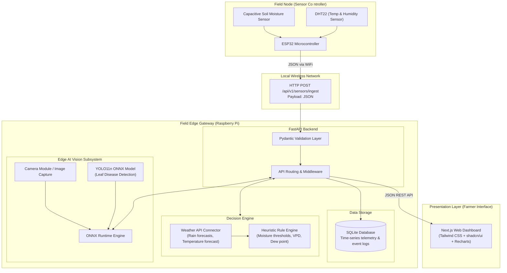

# System Architecture — Smart Farming Assistant

**SIH Problem Statement 26180**  
**Lead Architect Document**

---

## 1. Executive Summary & Design Principles

The Smart Farming Assistant is engineered to provide actionable agricultural intelligence to smallholder farmers while remaining cost-effective, robust, and explainable.

### Core Design Principles
1. **Simplicity First**: As a beginner-friendly hackathon architecture, each component has a single responsibility and clean boundaries.
2. **Modular Decoupling**: Hardware, backend, intelligence, and presentation are loosely coupled through strict JSON contracts.
3. **Dual-Environment Architecture**:
   - **Development**: Prototyped on standard PCs/laptops with modular mock-free components.
   - **Field Deployment**: Deployed on a field edge gateway (Raspberry Pi) communicating with low-power field nodes (ESP32).
4. **No Premature Complexity**: We start with lightweight in-memory and SQLite storage, rule-based decision logic, and standard ONNX runtime before adding distributed infrastructure.

---

## 2. End-to-End System Topology



---

## 3. Deployment Environments

### A. Development Environment (Current Phase)
* **ESP32 Node**: Connected to local development WiFi or test network.
* **Backend**: FastAPI running locally on developer PC (`http://127.0.0.1:8000`).
* **Database**: Local SQLite file (`./smart_farming.db`).
* **Frontend**: Next.js development server (`http://localhost:3000`).
* **AI Training & Testing**: Python scripts utilizing PyTorch and Ultralytics YOLO11n for training, followed by ONNX export.

### B. Eventual Field Deployment Environment
* **ESP32 (Sensor Controller)**:
  * Placed directly in the crop bed.
  * Powered by 3.7V 18650 Li-ion battery or solar power management board.
  * Connects to the local WiFi hotspot generated by the Raspberry Pi.
  * Reads sensors every configured interval (e.g., 30–60 seconds), formats a JSON packet, transmits it via HTTP POST, and enters light/deep sleep.
* **Raspberry Pi (Central Field Edge Gateway)**:
  * Hosts a local WiFi access point / hotspot in the field.
  * Runs the **FastAPI Backend**, serving both API endpoints and Next.js static production export.
  * Runs the **Decision Engine**, evaluating soil moisture against irrigation thresholds and local weather forecasts.
  * Runs **ONNX Runtime** locally on CPU/NPU for near-instant offline leaf disease diagnosis without relying on cloud internet.
  * Stores all historical readings in local **SQLite**, ensuring 100% offline resilience during field network drops.
* **Farmer Access**:
  * The farmer connects any smartphone/tablet to the Raspberry Pi's local WiFi network and opens the dashboard in a standard browser.

---

## 4. Subsystem Specifications

### 4.1 Hardware / IoT Subsystem (`esp32/`)
* **Role**: Dedicated sensor controller managed by **Sneha**.
* **Key Components**:
  * ESP32-WROOM-32 development board.
  * Capacitive Soil Moisture Sensor v1.2 (analog reading resistant to corrosion).
  * DHT22 digital temperature & humidity sensor.
* **Communication Contract**:
  * Protocol: HTTP/1.1
  * Method: `POST`
  * Content-Type: `application/json`
  * Endpoint: `/api/v1/sensors/ingest`
  * Payload:
    ```json
    {
      "sensor_id": "esp32_zone_1",
      "soil_moisture": 42.5,
      "temperature": 27.8,
      "humidity": 65.2,
      "battery_voltage": 3.92
    }
    ```

### 4.2 Backend & API Subsystem (`backend/`)
* **Role**: Data intake, schema validation, and coordination managed by **Vanshaj**.
* **Framework**: Python 3.10+, FastAPI, Pydantic v2.
* **Milestone 1 Scope**:
  * Health check endpoint (`GET /health`).
  * Sensor ingestion endpoint (`POST /api/v1/sensors/ingest`) with strict Pydantic range validation (e.g., soil moisture 0–100%, humidity 0–100%).
  * Latest sensor status endpoint (`GET /api/v1/sensors/latest`).
  * In-memory cache holding latest readings, ready to connect cleanly to SQLite in Milestone 2.

### 4.3 Decision Engine Subsystem
* **Role**: Actionable intelligence and climate risk managed by **Arnav**.
* **Logic**:
  * **Level 1 (Immediate Soil State)**: Moisture < 30% -> `IRRIGATION_NEEDED`; Moisture > 80% -> `OVERWATERING_WARNING`.
  * **Level 2 (Climate Forecast Context)**: If soil moisture is low BUT rain is forecast in next 6 hours -> `DELAY_IRRIGATION_RAIN_EXPECTED`.
  * **Level 3 (Fungal Risk)**: High humidity (> 85%) + high temperature (> 28°C) for extended duration -> `HIGH_FUNGAL_DISEASE_RISK`.

### 4.4 AI & Computer Vision Subsystem (`ai/`)
* **Role**: Leaf disease detection managed by **Diya** (Training) and **Aryan** (Inference).
* **Model**: YOLO11n (nano object detection / classification).
  * Selected for its balance of high accuracy and extremely low latency on edge hardware.
* **Edge Inference Pipeline**:
  * PyTorch `.pt` weights exported to open `.onnx` format.
  * Executed on Raspberry Pi using `onnxruntime` (C++ or Python runtime).
  * Avoids heavy ML dependencies (PyTorch/CUDA) in field deployment.

### 4.5 Frontend Subsystem (`frontend/`)
* **Role**: Responsive, clean interface for farmers managed by **Aryan** & **Vanshaj**.
* **Stack**: Next.js (App Router), TypeScript, Tailwind CSS, shadcn/ui, Recharts.
* **Views**:
  * Overview: Live sensor cards (moisture gauge, temperature, humidity).
  * Telemetry Trends: Time-series charts with Recharts.
  * Decision & Advisory Card: Clear natural-language farmer recommendations.
  * Crop Health Scanner: Photo upload interface for leaf diagnosis.

---

## 5. Security & Reliability Guidelines (Hackathon Scope)
1. **Graceful Degradation**: If weather API is unreachable, the Decision Engine falls back strictly to local sensor thresholds.
2. **Local First**: All sensor logging and decisions must operate without an active internet connection.
3. **Data Integrity**: Invalid sensor readings (e.g., sensor disconnected giving 0V or out-of-range values) are flagged and rejected at the Pydantic layer.
